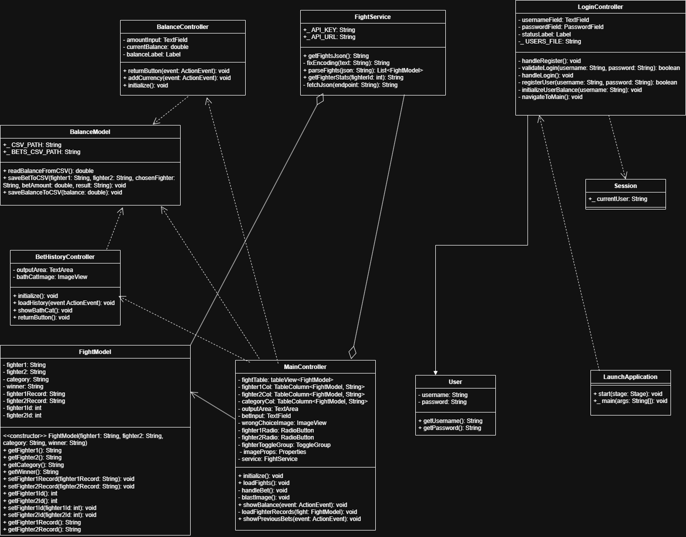

# Cage Kings

Cage Kings is a virtual MMA betting simulator that enables users to place bets and view data without real financial loss.

## Contributors
* **Robert Lloyd** - Developer, Documentation & Architecture
* **Clemente Fernandez** - Developer, QA & Version Control
* **Alden Walker** - Developer, Test Automation, Build & Data Integrity
* **Eddie Garcia** - Developer

## Application Features
* **Live Fight Data:** Fetches real-world fight data using the api-sports.io.
* **User Authentication:** Registration and login system with persistent (local) user profiles.
* **Bankroll Management:** Add virtual funds and track your balance across sessions.
* **Betting Simulator:** Place bets on upcoming or recent fights and see results immediately based on actual fight outcomes.
* **Betting History:** Track previous wagers and outcomes via the dedicated Bet History view.
* **Fighter Stats:** View fighter records (Wins/Losses/Draws) directly within the app.

## Project Structure (MVC Pattern)
The project strictly adheres to the Model-View-Controller architecture:
* **Models:** `FightModel.java`, `User.java`, `BalanceModel.java`, `Session.java`.
* **Views (FXML):** `login-view.fxml`, `main-screen.fxml` (Main), `balance.fxml`, `previous-bets.fxml`.
* **Controllers:** `LoginController.java`, `MainController.java`, `BalanceController.java`, `BetHistoryController.java`.
* **Services:** `FightService.java` (API communication and JSON parsing).

## Requirements
* **Java JDK 17 or higher**
* **Maven** (for dependency management)
* **Internet Access:** Required to fetch live fight data from the API.
* **JSON Library:** The project uses `org.json` for parsing API responses.

## Installation & Running Instructions

** Set up the SDK to Java 17 or higher **

1.  **Clone the Repository:**
    ```bash
    git clone https://github.com/UTSA-CS-3443/Spring2026-CS3443-Section003-XOR_Squad.git
    cd Spring2026-CS3443-Section003-XOR_Squad/CageKingsFX
    ```

2.  **Build the Project:**
    Using Maven:
    ```bash
    mvn clean install
    ```

3.  **Run the Application:**
    Execute the `Launcher` class to start the JavaFX environment:
    ```bash
    mvn javafx:run
    ```
    *Alternatively, run the `Launcher.java` file directly from your IDE.*

## Configuration

The API key is not committed. Before running, copy the example file and add your
api-sports.io key:

```bash
cp CageKingsFX/src/main/resources/config.properties_example CageKingsFX/src/main/resources/config.properties
```

Alternatively set the `CAGEKINGS_API_KEY` environment variable. Responses from the
fights endpoint are cached in `fights_cache.json` for 24 hours so repeated runs do
not consume API quota.

## Running the Tests

```bash
mvn test
```

30 JUnit 5 tests cover the JSON parsing and 24 hour response cache in
`FightService`, and the per-user CSV storage in `BalanceModel`. They run against
temporary directories and fixture payloads, so no network access or API key is
needed.

## Security

The api-sports.io key is never read from source. It is loaded from
`config.properties`, which is gitignored, or from the `CAGEKINGS_API_KEY`
environment variable.

Earlier revisions hardcoded a key in `FightService.java`. It was moved to config in
`e430eb6` and scrubbed from this repository's history, and the old key has since
expired, so it no longer works. Supply your own key when running this project.

## Known Issues & Limitations
* **API Rate Limits:** The free tier of the MMA API may limit the number of fighter record lookups. Responses are cached for 24 hours to reduce this.
* **Single Device Persistence:** User data is stored locally in CSV files within the `data/` directory and is not synced to a remote/server database.
* ** Errors stemming from trying to make it easy for the grader to run the application, but it works **

### Fixed
* **User data conflicts:** Balance and betting history used to overwrite one another
  because every account shared a single hardcoded `player1` row and each save
  truncated the file. Balances and bets are now keyed by username and scoped to the
  logged-in session.

## UML Diagram
The UML diagram illustrating the MVC relationships is located in the root of the repository as `UML_Diagram.png`. It details the interactions between the controllers and the service layer.

